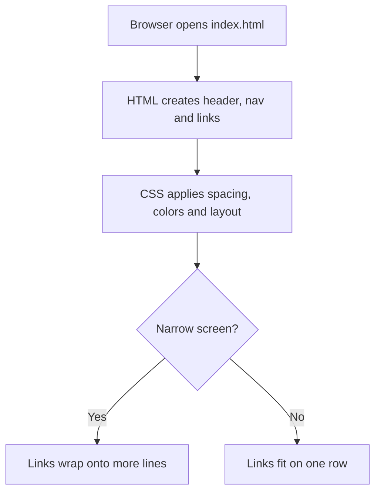

# Lesson 01 — HTML and CSS: A responsive navigation menu

**Practice project:** Foraging Forest (fictional). **Level:** foundations refresher. **Time:** work at your own pace.

## Goal

**Safety note:** This is a web-development exercise, not an identification or edibility guide. Never eat wild plants or mushrooms based on a website, photo, or app alone; consult qualified local experts.

Build a simple navigation bar that wraps cleanly on narrow screens. This lesson uses **only HTML and CSS**, so there is no installation, JavaScript, TypeScript, or Angular required.

## How the parts fit together



- **HTML** gives content its structure and meaning. The `nav` element identifies navigation to browsers and assistive technology.
- **CSS** describes its appearance. A class selector such as `.site-nav` targets elements with `class="site-nav"`.
- **Flexbox** distributes links across the available space; `flex-wrap: wrap` lets them move onto a new line instead of overflowing.

## Working example

Create a file called `index.html` and paste the complete example below. You can open it directly in a browser or use a browser-based HTML editor.

```html
<!doctype html>
<html lang="en">
<head>
  <meta charset="utf-8">
  <meta name="viewport" content="width=device-width, initial-scale=1">
  <title>Foraging Forest</title>
  <style>
    * { box-sizing: border-box; }
    body { margin: 0; font-family: system-ui, sans-serif; color: #173421; }
    .site-header { padding: 1rem; background: #dff3dc; }
    .site-header h1 { margin: 0 0 0.75rem; }
    .site-nav { display: flex; flex-wrap: wrap; gap: 0.5rem; }
    .site-nav a {
      display: inline-block;
      padding: 0.65rem 0.9rem;
      border-radius: 999px;
      background: #fff;
      color: #173421;
      font-weight: 700;
      text-decoration: none;
    }
    .site-nav a:hover,
    .site-nav a:focus-visible { outline: 3px solid #2d713e; outline-offset: 2px; }
    main { padding: 1rem; max-width: 60rem; margin: auto; }
    @media (max-width: 420px) {
      .site-nav a { flex: 1 1 auto; text-align: center; }
    }
  </style>
</head>
<body>
  <header class="site-header">
    <h1>Foraging Forest</h1>
    <nav class="site-nav" aria-label="Main navigation">
      <a href="#plants">Woodland Plants</a>
      <a href="#events">Forest Walks</a>
      <a href="#photos">Field Notes</a>
      <a href="#about">About</a>
    </nav>
  </header>
  <main>
    <h2 id="plants">Woodland Plants</h2><p>Explore woodland habitats and learn to identify plants responsibly.</p>
    <h2 id="events">Forest Walks</h2><p>Forest walks coming soon.</p>
    <h2 id="photos">Field Notes</h2><p>Field observations coming soon.</p>
    <h2 id="about">About</h2><p>We learn about forests while respecting wildlife and local regulations.</p>
  </main>
</body>
</html>
```

## Important decisions

**Why `viewport`?** It lets mobile browsers use the device width when laying out the page. Without it, a mobile browser may render a much wider virtual page and shrink it.

**Why `box-sizing: border-box`?** Declared widths then include padding and borders, which makes layout calculations more predictable.

**Why no JavaScript?** The links are ordinary anchors and the layout can respond to screen width using CSS alone. A collapsing dropdown with open/closed state would introduce another lesson about interaction and accessibility.

**Why use `focus-visible`?** Keyboard users need to see which link has focus. Hover alone does not cover keyboard navigation.

## Check the result

1. Open the page in a browser.
2. Tap **Events**. The browser should jump to the Events heading.
3. Make the window narrow (or view on a phone). Links should wrap instead of disappearing off-screen.
4. If you have a keyboard, press Tab to see the focus outline.
5. Increase browser text size and check that links remain readable.

## Try it yourself (optional)

- Change the background color to a color you like.
- Change `gap: 0.5rem` to `gap: 1rem` and compare the spacing.
- Temporarily remove `flex-wrap: wrap` and see what happens on a narrow screen. Put it back afterward.

## Quick reference

| Syntax | Meaning |
|---|---|
| `<nav>` | Semantic navigation region |
| `class="site-nav"` | Class attached to an HTML element |
| `.site-nav` | CSS selector matching that class |
| `display: flex` | Arrange children with Flexbox |
| `flex-wrap: wrap` | Allow children to wrap onto new rows |
| `gap` | Space between flex items |
| `@media` | Apply CSS only when a condition matches |
| `rem` | Unit based on the root font size |

## Resume point

**Completed:** a responsive HTML/CSS navigation bar with semantic links and visible keyboard focus.

**Next:** Lesson 02 can add a CSS-only layout comparison, then a later lesson can introduce JavaScript for an accessible dropdown menu.

**Privacy note:** This practice code is fictional and contains no Happy Furrbabbies source code or private notes.
